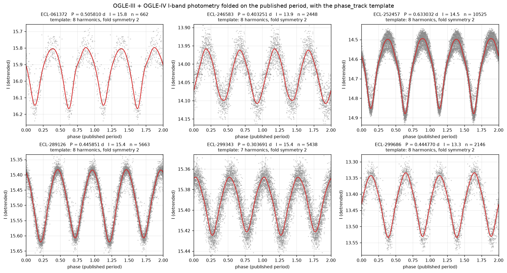
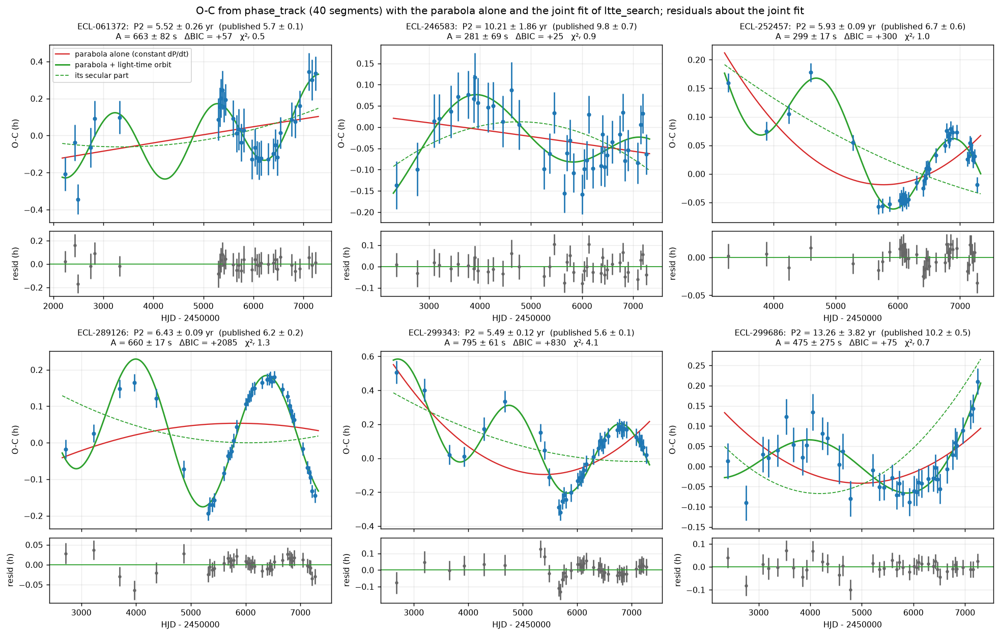
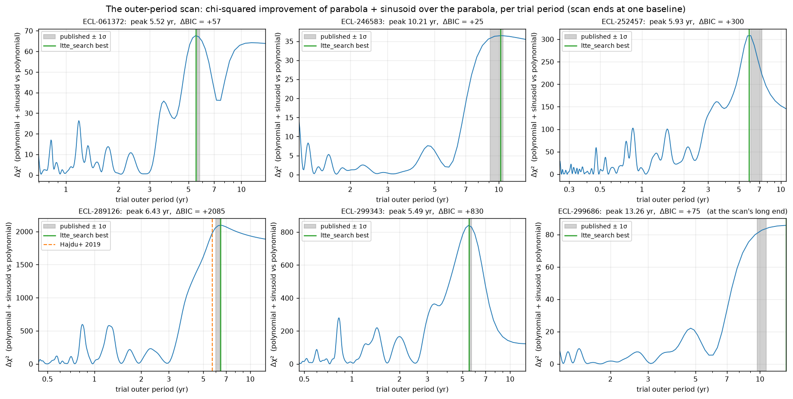
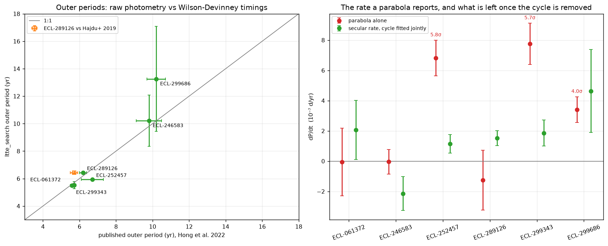
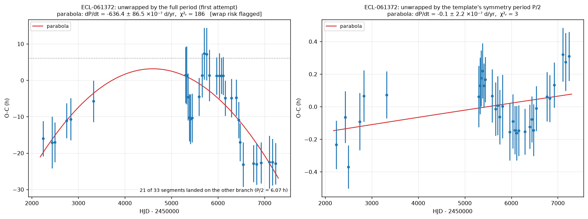
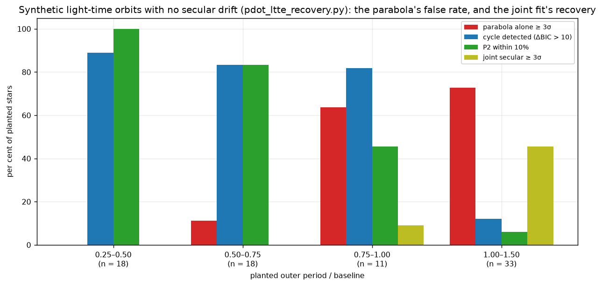

# cuPeriod on the Hong et al. (2022) OGLE triples

**Summary.** cuPeriod 1.3's period-change chain — `detrend` → `phase_track` → `ltte_search`, with the published inner period as its only input — was run on the raw OGLE-III + OGLE-IV *I*-band photometry of six bulge contact binaries that Hong et al. (2022) classify as having a *sinusoidal* eclipse-timing variation: a third body seen through the light-travel-time effect, with outer periods of 5.6–10.2 yr on a 14-yr baseline. That is the regime the feedback on the dP/dt feature pointed at — a period variation that is not monotonic, through which a parabola returns a rate of arbitrary sign. Findings:

* **All six outer periods are recovered within 2σ of the published values** (four within 1σ; median offset 4%) from survey photometry alone, with no per-season binary modelling (§3.4, Figure 4).
* **A parabola alone reports a 4.0–5.8σ "dP/dt" on three of the six stars**, rates of 3.4–7.8 × 10⁻⁷ d/yr — the size of the typical secular rate in Hong et al.'s catalogue — although Hong et al. find no parabola in any of the six. With the cycle fitted jointly, the secular rates fall to 1.0–3.1σ (§3.5, Table 3).
* The light-time amplitudes of 280–800 s give mass functions of 0.002–0.13 M☉ and minimum third-body masses of 0.17–0.92 M☉ for a 1.5 M☉ binary (§3.6). Two of the six prefer an eccentric outer orbit (§3.7).
* The benchmark exposed a failure mode the tracker now handles: an equal-minima contact binary has a template that is symmetric under a half-period shift, and on four of the six stars up to two thirds of the segments landed on the wrong branch, producing hour-scale "orbits" and 7–14σ parabolas. `phase_track` now unwraps by the template's symmetry period (§4).
* The whole chain runs in about a second per star on the CPU.

## 1 — Background: what Hong et al. did, and why these six

Hong et al. (2022) measured eclipse-timing variations for 14,127 contact eclipsing binaries in the OGLE-III and OGLE-IV bulge fields (2001–2015). Their timings are one time of minimum per observing season, obtained by fitting a binary model to each full seasonal light curve; a parabola, a sinusoid, or both were then fitted to the O−C diagram. The machine-readable tables (VizieR J/AJ/163/157) partition the sample: 13,716 stars with a parabola (a secular dP/dt), 307 with a sinusoid alone, and 104 with both. Three numbers from those tables set the scale for everything below:

| Hong et al. (2022), from the VizieR tables | value |
| --- | --- |
| secular rates (13,716 stars): median \|dP/dt\| | 7.7 × 10⁻⁷ d/yr (10th–90th percentile 3.0 × 10⁻⁷ – 1.7 × 10⁻⁶) |
| their median quoted error on dP/dt | 9.5 × 10⁻⁸ d/yr |
| sinusoidal systems (307 stars): outer periods | 5.0–14.0 yr, median 9.0 yr, on a ≈15 yr baseline |

So the detected rates sit at ~10⁻⁶ d/yr (~3 × 10⁻⁹ s/s), as the feedback said, and every one of the 307 cyclic systems has an outer period between a third of the baseline and the whole of it — exactly where a parabola cannot be trusted.

Six of the 307 sinusoidal systems were chosen by hand, for brightness (I = 13.3–15.8) and for an outer period the baseline covers at least once. Their O−C diagrams were not inspected first. None of the six appears in Hong et al.'s "parabola + sinusoid" table, so their published model is a sinusoid on a *linear* ephemeris — Hong et al. found no secular rate in any of them. One, OGLE-BLG-ECL-289126, also has an independent light-time solution from Hajdu et al. (2019): 5.7 ± 0.2 yr.

## 2 — What was run

**Data.** OGLE-III and OGLE-IV *I*-band photometry from the OGLE Collection of Variable Stars (`ftp.astrouw.edu.pl/ogle/ogle4/OCVS/blg/ecl/`, Soszyński et al. 2016), concatenated and time-sorted: 662–10,525 points per star over 14.2–14.3 yr (Table 1). `download_ogle_triples.py` fetches them into `data/ogle_triples/`.

**Recipe** (`pdot_ogle_triples.py`), identical for every star, with the published inner period as its only input:

1. `detrend(t, mag, 40.0)` — a 40-day running median, which also absorbs the OGLE-III/OGLE-IV zero-point offset.
2. `phase_track((t, flat, err), period=P, settings=PdotSettings(n_segments=40, max_harmonics=8))` — a multi-harmonic template (order chosen by BIC, up to 8 harmonics) is fitted to the whole light curve, then re-fitted for a time shift in each of 40 equal-count segments (20–264 points each; the faintest star yields 33 segments). The shifts are the O−C, the segment errors are Fisher errors from the template slope, and a quadratic ephemeris through them is what a "parabola alone" analysis reports.
3. `track.ltte_search(settings=...)` — at every trial outer period from four median segment spacings (or 20 inner periods, whichever is longer) up to the O−C baseline, a parabola plus a circular Irwin (1952) light-time orbit is fitted linearly (the orbit enters through *A* cos ω and *A* sin ω); the best trial is polished by nonlinear least squares and reported next to the parabola-only fit — ΔBIC and an F-test for the cycle, and the *secular* dP/dt with the cycle removed. Options used in §3.7: an eccentric polish (`eccentric=True`), a linear ephemeris (`degree=1`), and a scan opened beyond one cycle (`ltte_min_cycles=0.5`).

Quoted errors are the formal covariance errors inflated by √χ²ᵣ wherever χ²ᵣ > 1. The O−C baseline — the span of the segment mid-times — is 10.9–13.7 yr, and the scan ends there because a cycle longer than the baseline is degenerate with the polynomial. `report_ogle_triples.py` re-runs the chain with the extra models and renders every figure and table below.

### Table 1 — the sample and the tracking

| Star | I | P (d) | points | baseline (yr) | segments | template harmonics | fold symmetry |
| --- | --- | --- | --- | --- | --- | --- | --- |
| ECL-061372 | 15.8 | 0.505810 | 662 | 14.2 | 33 | 8 | 2 |
| ECL-246583 | 13.9 | 0.403251 | 2448 | 14.3 | 40 | 8 | 2 |
| ECL-252457 | 14.5 | 0.633032 | 10525 | 14.3 | 40 | 8 | 2 |
| ECL-289126 | 15.4 | 0.445851 | 5663 | 14.3 | 40 | 8 | 2 |
| ECL-299343 | 15.4 | 0.303691 | 5438 | 14.3 | 40 | 7 | 2 |
| ECL-299686 | 13.3 | 0.444770 | 2146 | 14.3 | 40 | 8 | 2 |

Star names are OGLE-BLG-ECL-NNNNNN throughout; I and P are Hong et al.'s.

## 3 — Results

### 3.1 The light curves and their templates



*Figure 1. The detrended photometry folded on the published period, with the template `phase_track` fitted (red). All six are W UMa-type curves with near-equal minima, so every template is almost symmetric under a half-period shift ("fold symmetry 2") — the property behind §4.*

### 3.2 The O−C diagrams



*Figure 2. Segment O−C (blue) with the parabola alone (red), the joint parabola + light-time orbit (green) and the secular part of the joint fit (dashed). Lower panels: residuals about the joint fit. Error bars are the segment timing errors inflated by √χ²ᵣ of the joint fit. The vertical zero point is the constant term of the joint fit.*

Every star shows the signature the feedback described: an O−C that turns over within the baseline. The parabola threads through the cycle, and its curvature depends on where the dense OGLE-IV sampling falls in the cycle rather than on how many cycles are covered: it is nearly flat on ECL-061372 and ECL-289126 but strongly curved on ECL-299343, which covers a similar number of cycles. The joint fit follows the points; its secular part (dashed) is nearly flat on five of the six.

### Table 2 — the light-time orbits

| Star | P2 (yr), this work | P2 (yr), Hong et al. | other | agreement | A (s) | cycles covered | ΔBIC | χ²ᵣ (joint) |
| --- | --- | --- | --- | --- | --- | --- | --- | --- |
| ECL-061372 | 5.52 ± 0.26 | 5.7 ± 0.1 | — | 0.6σ | 663 ± 82 | 2.48 | +57 | 0.5 |
| ECL-246583 | 10.21 ± 1.86 | 9.8 ± 0.7 | — | 0.2σ | 281 ± 69 | 1.31 | +25 | 0.9 |
| ECL-252457 | 5.93 ± 0.09 | 6.7 ± 0.6 | — | 1.3σ | 299 ± 17 | 1.85 | +300 | 1.0 |
| ECL-289126 | 6.43 ± 0.09 | 6.2 ± 0.2 | 5.7 ± 0.2 (Hajdu+ 2019) | 1.1σ | 660 ± 17 | 1.94 | +2085 | 1.3 |
| ECL-299343 | 5.49 ± 0.12 | 5.6 ± 0.1 | — | 0.7σ | 795 ± 61 | 2.29 | +830 | 4.1 |
| ECL-299686 | 13.26 ± 3.82 (scan edge) | 10.2 ± 0.5 | — | 0.8σ | 475 ± 275 | 1.00 | +75 | 0.7 |

"Agreement" is |P2 − P2,pub| over the quadrature sum of the two errors. ΔBIC is BIC(parabola) − BIC(parabola + orbit); positive favours the orbit. "Cycles covered" is the O−C baseline over the recovered outer period.

The cycle is decisive on every star (ΔBIC from +25 to +2085; the F-test p-values are all below 10⁻⁵). The joint fit describes the O−C to within its errors on four stars (χ²ᵣ 0.5–1.3); ECL-299343 is left with χ²ᵣ = 4.1, which §3.7 traces to an eccentric orbit.

### 3.3 The outer-period scan



*Figure 3. The floating-polynomial periodogram: the χ² improvement of parabola + sinusoid over the parabola alone, per trial outer period (106–421 trials per star, ten per Rayleigh width). Grey band: the published period ± 1σ; green: the polished best fit; orange dashed: Hajdu et al. (2019) for ECL-289126. The scan ends at each star's O−C baseline.*

The published periods sit on the main peak of every scan. The width of that peak is set by how many cycles the baseline holds: two and a half cycles on ECL-061372 give a peak a few tenths of a year wide, one and a third on ECL-246583 a peak several years wide, and on ECL-299686 the curve is still rising at the edge of the scan (§3.4). The structure at 0.8–1.2 yr is the yearly-window alias of a bulge field observed for eight months a year; it never competes with the main peak here.

### 3.4 Agreement with the published orbits



*Figure 4. Left: the recovered outer period against Hong et al.'s, with the independent Hajdu et al. (2019) value for ECL-289126 as the open square. Right: the dP/dt a parabola alone reports (red) and the secular rate of the joint fit (green); the labels mark the parabola's rates above 3σ.*

All six periods agree within 1.3σ. On five of them the recovered period carries an error of 1.4–18% and the agreement is a real test; the sixth is discussed below. Two cases deserve comment:

* **ECL-289126** has two published values, 6.2 ± 0.2 yr (Hong et al.) and 5.7 ± 0.2 yr (Hajdu et al. 2019, from an eclipse-timing analysis of the OGLE-IV data). The circular fit here, 6.43 ± 0.09 yr, agrees with the former; the eccentric fit (§3.7) gives 6.21 ± 0.06 yr.
* **ECL-299686** is the one star whose recovered period is not well constrained: 13.3 ± 3.8 yr against 10.2 ± 0.5 yr. Its O−C baseline of 13.3 yr holds exactly one cycle at the recovered period, the scan peaks at its long end, and the result carries the `at_grid_edge` flag. Opening the scan to half a cycle does not help (14.7 ± 5.7 yr, still at the edge), nor does Hong et al.'s own model of a sinusoid on a linear ephemeris (13.3 ± 2.9 yr, Table 5). The "0.8σ agreement" is the large error at work, not a measurement of 10 yr; the honest statement is that on this star the polynomial and a cycle as long as the baseline are partly degenerate, which is what the flag says.

### 3.5 What a parabola alone would have reported

### Table 3 — the rate a parabola reports, and the secular rate

| Star | parabola alone, dP/dt (10⁻⁷ d/yr) | S/N | χ²ᵣ (parabola) | F-test p (quadratic vs linear) | secular dP/dt (10⁻⁷ d/yr) | S/N | floor from the timing errors (10⁻⁷ d/yr) |
| --- | --- | --- | --- | --- | --- | --- | --- |
| ECL-061372 | -0.05 ± 2.23 | 0.0 | 2.7 | 9.8e-01 | +2.06 ± 1.96 | 1.0 | 1.37 |
| ECL-246583 | -0.04 ± 0.81 | 0.0 | 1.8 | 9.7e-01 | -2.14 ± 1.12 | 1.9 | 0.56 |
| ECL-252457 | +6.81 ± 1.18 | 5.8 | 9.3 | 1.4e-06 | +1.14 ± 0.61 | 1.8 | 0.36 |
| ECL-289126 | -1.25 ± 1.97 | 0.6 | 57.9 | 5.3e-01 | +1.52 ± 0.49 | 3.1 | 0.26 |
| ECL-299343 | +7.76 ± 1.36 | 5.7 | 26.5 | 1.6e-06 | +1.86 ± 0.86 | 2.2 | 0.47 |
| ECL-299686 | +3.41 ± 0.85 | 4.0 | 2.9 | 3.0e-04 | +4.64 ± 2.75 | 1.7 | 0.46 |

The "floor" is `detectable_pdot` evaluated at the actual segment epochs and the (inflated) median timing error: the formal 1σ on dP/dt that a quadratic ephemeris could reach with no cycle to fit.

This table is the point of the benchmark. On three stars the parabola alone reports a period change at 4.0–5.8σ, and by the tests an O−C analysis would normally apply it looks real: the F-test of the quadratic against a linear ephemeris gives p ≈ 10⁻⁶ on the two worst cases, and the quoted errors already include the √χ²ᵣ inflation. The rates, +3.4 to +7.8 × 10⁻⁷ d/yr, are indistinguishable in size from the median secular rate in Hong et al.'s catalogue (7.7 × 10⁻⁷ d/yr), so nothing about their magnitude gives them away. They are also all positive, which is a coincidence of where the cycle falls in the baseline (the simulations of §5 produce both signs). Hong et al., with a sinusoid in the model, list no parabola for any of the six.

Two internal signs would have raised suspicion. The parabola's χ²ᵣ is 9.3, 26.5 and 57.9 on three stars, against 1.0, 4.1 and 1.3 once the cycle is included — but a χ²ᵣ of 58 comes with a 0.6σ rate on ECL-289126, and a χ²ᵣ of 2.9 with a 4.0σ rate on ECL-299686, so it is a warning and not a test. And the O−C plot turns over visibly on every star, which is the reliable check and the reason `cuperiod pdot` always draws it.

With the cycle fitted jointly, the secular rates are 1.0–3.1σ. The largest, +1.5 ± 0.5 × 10⁻⁷ d/yr on ECL-289126, is model-dependent at that level (the eccentric orbit preferred in §3.7 changes the polynomial too) and should be read as "not excluded", consistent with Hong et al. reporting none. The formal floors in the last column, 0.3–1.4 × 10⁻⁷ d/yr, are what the timing precision would allow; the joint fits sit two to four times above them because the orbit shares the baseline with the parabola.

### 3.6 What the orbits imply

### Table 4 — what the orbits imply

| Star | a₁₂ sin i (au) | f(m) (M☉) | m₃ sin i ≥ (M☉, for M₁₂ = 1.5 M☉) |
| --- | --- | --- | --- |
| ECL-061372 | 1.329 | 0.0770 | 0.73 |
| ECL-246583 | 0.563 | 0.0017 | 0.17 |
| ECL-252457 | 0.599 | 0.0061 | 0.27 |
| ECL-289126 | 1.322 | 0.0558 | 0.63 |
| ECL-299343 | 1.593 | 0.1340 | 0.92 |
| ECL-299686 | 0.952 | 0.0049 | 0.25 |

`LTTEFit.a_sini_au` is the light-time amplitude in light-seconds over 499.005 s au⁻¹; `mass_function` is (a₁₂ sin i)³ / P2², and `minimum_third_mass(1.5)` solves the mass-function cubic for sin i = 1 with an assumed 1.5 M☉ contact binary (a typical W UMa total mass; the true companions are heavier for any lower inclination). The minimum companions range from an M dwarf (ECL-246583) to stars comparable to the binary's own components (ECL-061372, ECL-289126, ECL-299343). Because f(m) scales as A³, the amplitude error dominates: ±12% on A for ECL-061372 is ±37% on f(m), and for ECL-299686 the amplitude is barely measured.

### 3.7 Other models: a linear ephemeris, an eccentric orbit, a longer scan

### Table 5 — other models: a linear ephemeris, an eccentric orbit, a scan opened to half a cycle

| Star | P2 (yr), sinusoid on a linear ephemeris | e | P2 (yr), eccentric fit | A (s), eccentric fit | ΔBIC eccentric − circular | P2 (yr), scan to half a cycle |
| --- | --- | --- | --- | --- | --- | --- |
| ECL-061372 | 5.55 ± 0.25 | 0.20 ± 0.29 | 5.61 ± 0.27 | 681 ± 91 | +6.4 | 5.52 ± 0.26 |
| ECL-246583 | 13.41 ± 5.57 (scan edge) | 0.18 ± 0.35 | 9.77 ± 1.25 | 270 ± 53 | +7.1 | 10.21 ± 1.86 |
| ECL-252457 | 5.95 ± 0.09 | 0.33 ± 0.11 | 5.80 ± 0.10 | 348 ± 39 | -4.7 | 5.93 ± 0.09 |
| ECL-289126 | 6.62 ± 0.09 | 0.28 ± 0.05 | 6.21 ± 0.06 | 697 ± 20 | -16.9 | 6.43 ± 0.09 |
| ECL-299343 | 5.61 ± 0.11 | 0.51 ± 0.05 | 5.44 ± 0.06 | 1043 ± 60 | -104.0 | 5.49 ± 0.12 |
| ECL-299686 | 13.26 ± 2.94 (scan edge) | 0.51 ± 0.17 | 13.26 ± 4.48 | 1285 ± 3188 | +1.3 | 14.74 ± 5.69 |

Negative ΔBIC favours the eccentric orbit.

* **The ephemeris polynomial matters at the few-per-cent level.** Hong et al.'s model is a sinusoid on a linear ephemeris (`degree=1`). On the four stars with two or more cycles it moves the outer period by 0.02–0.2 yr (up to 3%), comparable to the quoted errors; on ECL-246583, with 1.3 cycles, removing the parabola pushes the peak to the scan edge (13.4 ± 5.6 yr) where the joint fit had given 10.2 ± 1.9 yr against a published 9.8 ± 0.7. At around one cycle the polynomial and the orbit share the baseline, and which model is "right" is a prior, not a measurement.
* **Two orbits are eccentric.** ECL-299343 (e = 0.51 ± 0.05, ΔBIC = −104) and ECL-289126 (e = 0.28 ± 0.05, ΔBIC = −17) prefer Irwin's full model; ECL-252457 marginally so. Eccentricity is what the circular fit's χ²ᵣ = 4.1 on ECL-299343 was pointing at, and it changes the amplitude — from 795 to 1043 s on that star, a factor 2.3 in f(m) — so the masses of Table 4 are model-dependent to that extent. On ECL-299686 the eccentric fit is unconstrained (A = 1285 ± 3188 s) and the circular one is the one to keep. Hong et al. fitted sinusoids only, so there is no published eccentricity to compare against.

## 4 — The half-period trap



*Figure 5. ECL-061372, the worst case. Left: the O−C when consecutive segment delays are unwrapped by the full period, as the tracker did before this benchmark; 21 of 33 segments land on the branch half a period (6.07 h, dotted line) away, and the parabola through them reports dP/dt = −6.4 × 10⁻⁵ d/yr at 7σ. Right: the same segments unwrapped by the template's symmetry period P/2.*

### Table 6 — the half-period slips of the first attempt

| Star | segments on the other branch | parabola dP/dt then (10⁻⁷ d/yr) | χ²ᵣ then | wrap risk flagged then |
| --- | --- | --- | --- | --- |
| ECL-061372 | 21 / 33 | -636.4 ± 86.5 | 186 | yes |
| ECL-246583 | 11 / 40 | -507.5 ± 40.9 | 1303 | yes |
| ECL-252457 | 0 / 40 | 6.8 ± 1.2 | 9 | no |
| ECL-289126 | 0 / 40 | -1.3 ± 2.0 | 58 | no |
| ECL-299343 | 19 / 40 | -347.0 ± 25.5 | 863 | yes |
| ECL-299686 | 10 / 40 | -798.9 ± 74.7 | 734 | yes |

A contact binary with equal minima has a light curve that is very nearly periodic in P/2: the template's odd harmonics carry almost no power. A segment's best template shift then lands on either of two branches half a period apart, decided by noise, and the tracker's unwrapping — which assumed that consecutive delays differ by less than half a period — stitched the branches into a sawtooth. On four of the six stars a quarter to two thirds of the segments slipped; the parabola through the result reported period changes of 3.5–8.0 × 10⁻⁵ d/yr at 7–14σ (a hundred times the median rate in Hong et al.'s catalogue), and the template re-derivation that follows the first pass then folded that curvature into the warp. The `wrap_risk` flag fired on all four, which is the safeguard a batch user would have had; a user reading only the rate columns would not have been saved.

`phase_track` now measures the template's fold symmetry — the largest *m* (4, 3, 2) for which the harmonics that are not multiples of *m* hold under 5% of the template's power — and unwraps consecutive delays by P/*m*, scaling `wrap_risk` the same way. `PhaseTrackResult.symmetry_order` records the value (2 on all six stars, Table 1). The right-hand panel of Figure 5, and every number in §3, is the result. The cost of the symmetry is a genuine ambiguity: a delay of P/2 is indistinguishable from none on such a star, so the O−C is measured modulo P/2 and a real jump of half a period (a swap of primary and secondary minimum) could not be seen; nothing in this sample suggests one.

## 5 — Context from simulation



*Figure 6. `pdot_ltte_recovery.py`: 80 synthetic light curves (3000-day baseline, 1500 points, 0.03 mag noise, 30 segments) with a planted circular light-time orbit of 120–600 s and no secular drift, plus 40 with no orbit at all, run through the same chain. Bars are per bin of planted outer period over baseline.*

### Table 7 — synthetic light-time orbits (pdot_ltte_recovery.py)

| P2 / baseline | n | parabola alone ≥ 3σ | cycle detected (ΔBIC > 10) | P2 within 10% | joint secular ≥ 3σ |
| --- | --- | --- | --- | --- | --- |
| 0.25–0.50 | 18 | 0% | 89% | 100% | 0% |
| 0.50–0.75 | 18 | 11% | 83% | 83% | 0% |
| 0.75–1.00 | 11 | 64% | 82% | 45% | 9% |
| 1.00–1.50 | 33 | 73% | 12% | 6% | 45% |

Nulls (no orbit, n = 40): cycle falsely detected on 0%, parabola ≥ 3σ on 0%; median 0.07 s per star for tracking + search.

The simulation places the six real stars on a curve. With the cycle covered at least once, the outer period is recovered within 10% on 81% of the planted stars and the cycle is detected on 85%; the parabola's false rate climbs from zero at a quarter of the baseline to 64% at three quarters to one. Beyond one cycle the joint fit can no longer separate the orbit from the parabola either (12% detected, 45% false secular rates), which is the regime ECL-299686 sits in and the reason the default scan stops at one baseline. Hong et al.'s 307 sinusoidal systems, with outer periods of 0.3–0.9 baselines, fall almost entirely in the bins where the joint fit works and the parabola does not.

## 6 — Caveats

* **Six stars, chosen for brightness.** This is a demonstration on the bright end of the catalogue (I ≤ 15.8), not a completeness or purity measurement; the remaining 301 sinusoidal systems, and the 104 with both variations, are fetchable the same way and would be the natural next test.
* **The comparison values are not independent data.** Hong et al.'s and Hajdu et al.'s orbits come from the same OGLE photometry, reduced to per-season timings by binary modelling. The agreement therefore tests the method (template tracking of raw survey points against Wilson–Devinney seasonal timings), not the reality of the companions.
* **The inner period was taken from the paper.** A survey pipeline would get it from cuPeriod's own period search; nothing here depends on that step.
* **The circular orbit is the default.** Two stars prefer an eccentric one, and their amplitudes and mass functions move by up to a factor 2.3 (§3.7). A classification should quote the circular numbers and flag the eccentric preference, as the tables here do.
* **One cycle is not enough.** ECL-299686 (and ECL-246583 without a parabola) sit at the scan edge; `at_grid_edge` and `n_cycles` say so, and only a longer baseline or archival timings (the AAVSO and var.astro.cz databases documented in the guide) can settle them.
* **The published table carries no amplitudes**, so only outer periods are compared; the eccentricities have no published counterpart either.
* **Timing errors are formal.** The χ²ᵣ of the joint fits (0.5–4.1) show that the segment errors are honest to within a factor two on five stars; the quoted errors carry the √χ²ᵣ inflation.

## 7 — Reproducing this report

From the repository root, in the main environment (`pip install -e ".[gpu]"` or the CPU extras; nothing here uses the GPU):

```bash
python benchmarks/download_ogle_triples.py
```

```bash
python benchmarks/pdot_ogle_triples.py
```

```bash
python benchmarks/report_ogle_triples.py
```

The first fetches the twelve OGLE photometry files into `benchmarks/data/ogle_triples/` (gitignored). The second runs the benchmark chain, writes `results/pdot_ogle_triples.parquet` and the overview figure `figures/ogle_triples_oc.png`, and prints the per-star summary. The third re-runs the chain with the extra models of §3.7 and §4, writes `figures/ogle_triples/fig1–fig6` and `results/ogle_triples_tables.md` (the tables above), and needs `results/pdot_ltte_recovery.parquet` from `pdot_ltte_recovery.py` for Figure 6 and Table 7. The whole of the third script takes about 15 s.

## References

* Hong, K., et al. 2022, AJ, 163, 157 — *Period Changes of 14,127 Contact Eclipsing Binaries in the Galactic Bulge* (doi:10.3847/1538-3881/ac4e98; VizieR J/AJ/163/157).
* Hajdu, T., Borkovits, T., Forgács-Dajka, E., et al. 2019, MNRAS, 485, 2562 — hierarchical triples among OGLE-IV bulge eclipsing binaries from eclipse-timing variations.
* Irwin, J. B. 1952, ApJ, 116, 211 — the light-time effect in eclipsing binaries.
* Soszyński, I., et al. 2016, AcA, 66, 405 — the OGLE Collection of Variable Stars: eclipsing binaries in the Galactic bulge.
* Pietrukowicz, P., et al. 2017, AcA, 67, 115 — period changes of bulge contact binaries from OGLE.
* cuPeriod user guide, *Period change*: `docs/guide/period-change.md` (the `ltte_search`, `detectable_pdot` and mass-loss sections).
